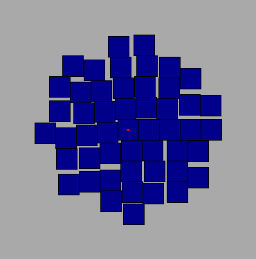
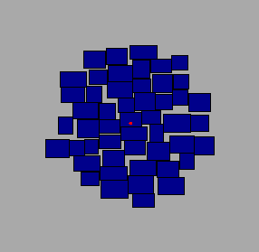

# Tags Cloud Visualisation Homework Savitskikh Anton

По условию задачи было предложено сгенерировать 2 раскладки облака тегов с разными параметрами
и сохранить их изображение в данный файл

## Первая раскладка - 50 прямоугольников одного размера

## Вторая раскладка - 50 прямоугольников рандомных размеров (ширина от 15 до 30 и высота от 15 до 30)
