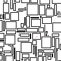
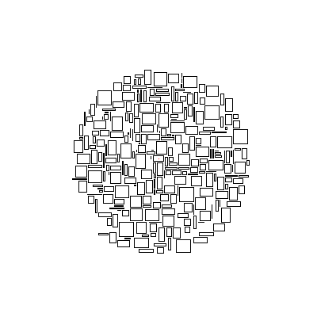

# Формирование облака тегов

# Входные параметры
- Point center - координаты центра облака тегов
- double spiralStep - шаг спирали, по которой будут располагаться теги
- double radiusOffset - коэффициент, определяющий расстояние между витками спирали
- int indent - отступ между тегами, чтобы они не слипались друг с другом

